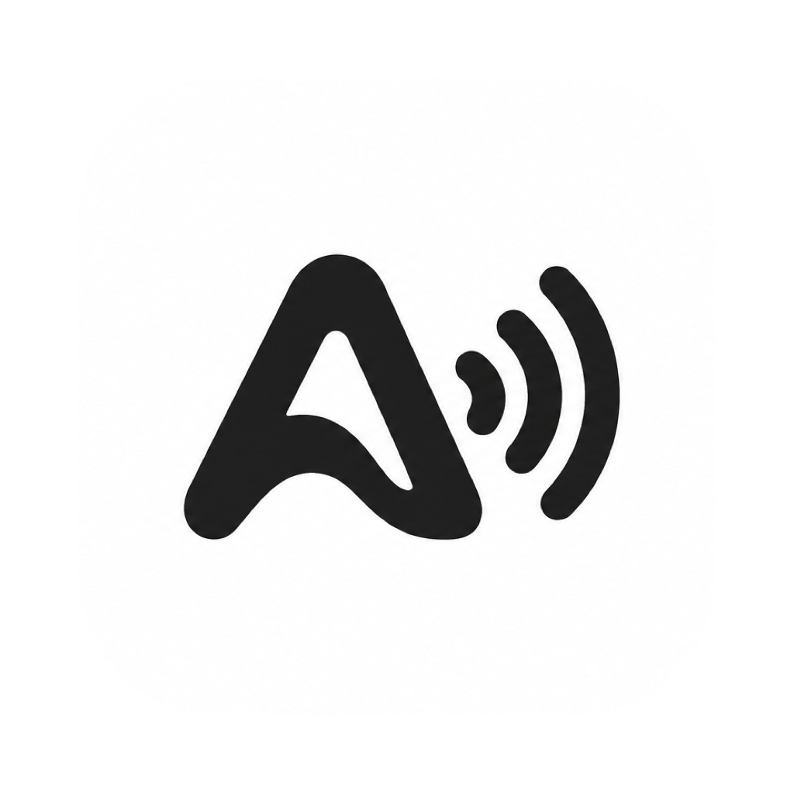

<p align="center">
  
</p>

<h1 align="center">Audra</h1>

<p align="center">
  Select text in any app, press <b>⌥⇧S</b>, and hear it read aloud in a natural voice that runs on your Mac.
</p>

<p align="center">
  <a href="https://github.com/buemura/audra/releases/latest">Download</a> ·
  <a href="#install">Install</a> ·
  <a href="#usage">Usage</a> ·
  <a href="#troubleshooting">Troubleshooting</a> ·
  <a href="#development">Development</a>
</p>

---

Audra is a small, free menu bar app for macOS. It reads aloud the text you select in Safari, Mail, Pages, PDFs, Slack, VS Code or any other app where you can highlight text. It doesn't store or send what it reads: speech is generated on your Mac.

## Features

- **Works in any app.** If you can select the text, Audra can read it.
- **One shortcut.** Press **⌥⇧S** (Option-Shift-S) to read, press it again to stop. You can change the shortcut.
- **Natural voices.** 51 neural voices (Kokoro) in English, Portuguese (Brazil), Spanish, French, Italian, Hindi, Japanese and Chinese (beta). Other languages use the voices installed on your Mac.
- **Picks the right voice.** Audra detects the language of the text and uses a matching voice. You can choose a voice for each language.
- **Floating player.** A small player stays above your other windows while Audra reads, with play/pause, slower, faster and stop. Drag it anywhere and resize it from the corner; it remembers where you put it.
- **Five speeds.** 0.5x, 1x, 1.5x, 2x and 2.5x.
- **Private.** Audra never saves or sends the text it reads. The only time it goes online is a one-time download of the natural voice model (about 190 MB) the first time it opens.

## Requirements

- macOS 15 Sequoia or later
- A Mac with Apple Silicon (M1 or later)
- About 190 MB of free disk space for the natural voices

## Install

### Option 1: Terminal (recommended)

Open **Terminal** (Applications → Utilities → Terminal), paste this line and press Return:

```bash
curl -fsSL https://raw.githubusercontent.com/buemura/audra/main/scripts/install.sh | bash
```

The script:

1. downloads the latest release and checks its checksum,
2. quits Audra if it's already running,
3. installs it into `/Applications` (it asks for your password only if your account can't write there),
4. opens it.

Apps installed this way aren't blocked by macOS on first launch, so you can skip straight to [Grant Accessibility access](#grant-accessibility-access).

To install a specific version, set `AUDRA_VERSION`:

```bash
curl -fsSL https://raw.githubusercontent.com/buemura/audra/main/scripts/install.sh | AUDRA_VERSION=0.1.1 bash
```

### Option 2: Download the DMG

1. Download `Audra-<version>.dmg` from the [latest release](https://github.com/buemura/audra/releases/latest).
2. Open the DMG and drag **Audra** onto the **Applications** folder.
3. Open Audra from Applications. Audra isn't notarized by Apple yet, so macOS blocks this first launch and shows a warning. Click **Done**.
4. Open **System Settings → Privacy & Security**, scroll down to the message about Audra and click **Open Anyway**. Confirm with your password or Touch ID.

You only need to do this once.

### Grant Accessibility access

The first time Audra opens, it asks for Accessibility access. Audra needs it to read the text you've selected in other apps.

1. Click **Open System Settings** in the prompt (or go to **System Settings → Privacy & Security → Accessibility**).
2. Turn on the switch next to **Audra**.

Until you do, the Audra menu shows **⚠️ Grant Accessibility Access…**, which takes you to the same place.

### First launch: natural voices

Audra downloads its natural voices (about 190 MB) the first time it opens. You'll see the progress in the Audra menu and in **Settings → General**. You can start reading right away: until the download finishes, Audra uses the voices built into your Mac.

### Update

Run the [Terminal command](#option-1-terminal-recommended) again. It replaces your copy with the latest release and keeps your settings and downloaded voices. If you installed from the DMG, download the new DMG and drag Audra to Applications again, choosing **Replace**.

After an update, macOS may stop trusting the old Accessibility permission. If reading stops working, see [Troubleshooting](#reading-stopped-working-after-an-update).

## Usage

### Read text

1. Select text in any app.
2. Press **⌥⇧S**.
3. Press **⌥⇧S** again to stop.

You can also click the Audra icon in the menu bar and choose **Read Selection**. If nothing is selected, Audra beeps.

### The menu bar menu

Click the Audra icon in the menu bar:

| Item | What it does |
| --- | --- |
| **Read Selection** | Reads the text selected in the frontmost app. |
| **Pause / Resume** | Pauses or resumes the current reading. |
| **Stop** | Stops reading. |
| **Speed** | Sets the reading speed: 0.5x, 1x, 1.5x, 2x or 2.5x. |
| **Show Player Always** | Keeps the floating player on screen even when nothing is being read. |
| **Settings…** (⌘,) | Opens the Settings window. |
| **Quit Audra** (⌘Q) | Quits the app. |

### The floating player

The player appears while Audra reads and hides itself a few seconds after reading stops. It shows the text being read, its progress, the voice and the detected language.

| Control | What it does |
| --- | --- |
| ▶ / ❚❚ | Reads the current selection, or pauses and resumes. |
| ◀◀ / ▶▶ | Slower / faster. |
| ■ | Stops reading. |
| **1x ▾** | Picks a speed. |

Drag the player by any empty spot to move it, and drag the bottom-right corner to resize it. It remembers its position.

### Settings

Open **Settings…** from the Audra menu.

**General**

- **Read / stop selection:** click the field and press a new shortcut to change it.
- **Speed:** the default reading speed.
- **Default voice:** the voice used when no language-specific voice applies.
- **Detect the language of the text and use a matching voice:** turn off to always use the default voice.
- **Natural voices:** shows the download status, with **Download**, **Retry** or **Remove**. Removing frees about 190 MB; Audra then uses your Mac's voices.

**Voices**

Choose a voice for each language, or leave it on **Automatic**. Natural voices are preferred once they're downloaded.

### Supported languages

| Language | Natural voices | Default voice |
| --- | --- | --- |
| English (US) | 19 | Heart |
| English (UK) | 8 | Emma |
| Portuguese (Brazil) | 2 | Dora |
| Spanish | 2 | Dora |
| French | 1 | Siwis |
| Italian | 2 | Sara |
| Hindi | 4 | Alpha |
| Japanese | 5 | Alpha |
| Chinese (beta) | 8 | Xiaobei |

Any other language uses the voices installed on your Mac. To get better ones, including Enhanced and Premium voices, go to **System Settings → Accessibility → Spoken Content → System Voice → Manage Voices**.

### Open Audra at login

Go to **System Settings → General → Login Items & Extensions**, click **+** under **Open at Login** and choose **Audra**.

## Troubleshooting

#### Nothing happens when I press ⌥⇧S

- Check that Audra is running: its icon should be in the menu bar.
- Check that Accessibility access is on in **System Settings → Privacy & Security → Accessibility**.
- Another app may be using the same shortcut. Choose a different one in **Settings → General**.

#### Reading stopped working after an update

macOS sometimes drops the Accessibility permission when the app changes. Reset it in Terminal:

```bash
tccutil reset Accessibility com.buemura.Audra
```

Then open Audra again and grant access when asked.

#### "Audra can't be opened" or "Apple could not verify Audra"

Audra isn't notarized yet. Follow steps 3–4 of [Download the DMG](#option-2-download-the-dmg), or install with the [Terminal command](#option-1-terminal-recommended), which avoids the warning.

#### It doesn't work in Chrome, Slack or VS Code

These apps don't share their selection with macOS. For them, Audra presses ⌘C, reads the copied text and then puts your previous clipboard contents back right away. Clipboard-history tools may still record that copy. If it still fails, make sure the text is actually selected and the app is in front.

#### The voice sounds robotic

The natural voices may still be downloading, or your text may be in a language they don't cover. Check the download in **Settings → General**, and pick a voice in **Settings → Voices**.

## Uninstall

1. Quit Audra from its menu.
2. Delete the app, its voices and its settings:

```bash
rm -rf /Applications/Audra.app "$HOME/Library/Application Support/Audra"
defaults delete com.buemura.Audra
tccutil reset Accessibility com.buemura.Audra
```

## How it works

- **Capturing the selection:** Audra first asks the macOS Accessibility API for the selected text. If the app doesn't expose it (Chrome, Electron apps), Audra copies it with ⌘C and restores your clipboard right away.
- **Choosing a voice:** Apple's NaturalLanguage framework detects the language; Audra then uses your voice choice for that language, a natural voice if one exists, or a system voice.
- **Speaking:** natural voices are generated on your Mac by [Kokoro-82M](https://huggingface.co/hexgrad/Kokoro-82M) running on Apple's [MLX](https://github.com/ml-explore/mlx-swift). Text is read sentence by sentence, with up to two sentences prepared ahead while the current one plays.

## Development

### Requirements

- Xcode 26 or later (Swift 6.2+)
- The Metal Toolchain: `xcodebuild -downloadComponent MetalToolchain`

### Commands

```bash
make run                             # build, reset the Accessibility grant and open the app
make test                            # run all tests (xcodebuild; ONLY=Target/TestClass for a subset)
swift test --filter AudraCoreTests   # fast: core logic only
./scripts/build-app.sh               # build "build/Audra.app" (Apple Silicon, ad-hoc signed)
./scripts/make-dmg.sh                # build build/Audra-<version>.dmg
make release                         # build the DMG and publish GitHub release v<version> (bump Support/Info.plist first)
open "build/Audra.app"
```

After each rebuild, macOS drops the Accessibility grant because the ad-hoc signature changes. `make run` resets it for you; otherwise reset it and grant access again:

```bash
tccutil reset Accessibility com.buemura.Audra
```

### Project layout

- `Sources/AudraCore` — all logic (speech, voices, language detection, text capture, settings), unit-tested.
- `Sources/AudraKokoro` — the Kokoro engine (MLX) and the English/eSpeak phonemizers.
- `Sources/AudraApp` — SwiftUI menu bar app, floating player and settings window.
- `Packages/` — vendored KokoroSwift (patched) and eSpeak NG; see their `VENDORED.md`.
- `scripts/prepare-kokoro-assets.py` — builds the model files published at https://github.com/buemura/audra-models/releases.
- `Support/Info.plist`, `scripts/` — app bundle, DMG packaging, release and install scripts.
- `website/` — the project website (static HTML; preview with `cd website && python3 -m http.server`).

## Roadmap

- Developer ID signing and notarization
- Windows and Linux versions

## Tech stack

- Swift, SwiftUI, AVFoundation, NaturalLanguage, Accessibility API
- [Kokoro-82M](https://huggingface.co/hexgrad/Kokoro-82M) on [MLX Swift](https://github.com/ml-explore/mlx-swift) via [KokoroSwift](https://github.com/mlalma/kokoro-ios)
- [MisakiSwift](https://github.com/mlalma/MisakiSwift) and [eSpeak NG](https://github.com/espeak-ng/espeak-ng) for pronunciation
- [KeyboardShortcuts](https://github.com/sindresorhus/KeyboardShortcuts)

## License

GPL-3.0 (see [`LICENSE`](LICENSE)). Third-party components are listed in [`THIRD_PARTY_NOTICES.md`](THIRD_PARTY_NOTICES.md).
